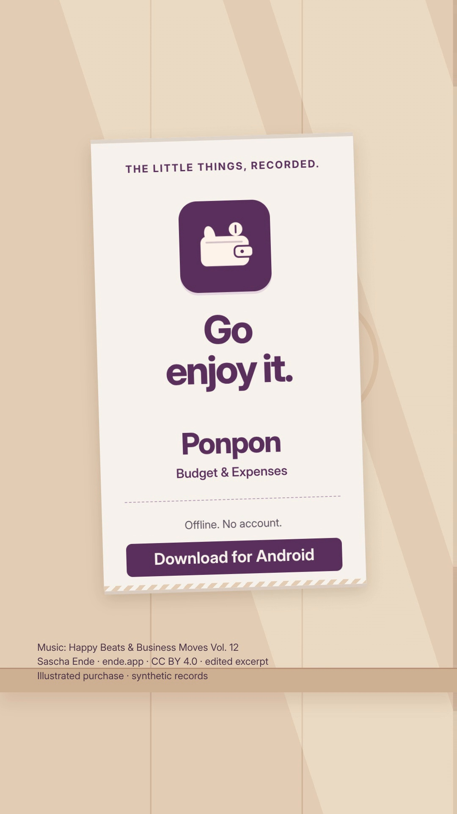

# Ponpon — Budget & Expenses

> Previously Pocket Entry. The source currently published here is version **0.2.0** and retains Pocket Entry branding. The ad below previews Ponpon 0.2.2 using synthetic records and the verified wallet icon.

**One entry at a time.** An offline Android ledger for quick, deliberate expense recording. Version **0.2.0** · Flutter · Android 8.0 / API 26+

Choose a category, enter an amount, and explicitly choose the wallet. Cash, GCash, and custom wallets are manually tracked; Ponpon has no bank connection and never moves real money. A new installation starts empty.

## Watch the ad

**Before you walk away** · 21.5 seconds

<a href="https://raw.githubusercontent.com/FrancisGiann/Ponpon/main/docs/media/ads/Ponpon-before-you-walk-away.mp4">
  
</a>

[Watch or download the ad (MP4)](https://raw.githubusercontent.com/FrancisGiann/Ponpon/main/docs/media/ads/Ponpon-before-you-walk-away.mp4) · [View file on GitHub](docs/media/ads/Ponpon-before-you-walk-away.mp4) · [Caption and credits](docs/media/ads/Ponpon-caption-and-credits.txt)

An illustrated purchase scene uses Ponpon 0.2.2 screens with synthetic records and the verified wallet icon. Cash and GCash are manually recorded wallets. This is staged product footage.

Music: [Happy Beats & Business Moves Vol. 12](https://ende.app/en/song/12881-happy-beats-business-moves-vol-12) by Sascha Ende, [CC BY 4.0](https://creativecommons.org/licenses/by/4.0/). Excerpted, faded, gain adjusted, normalized and mixed with sound accents. Full credits are linked above.

## Included

- Expenses, income, transfers, history filters, editable entries, recoverable deletion, and persistent undo.
- Cash, GCash, and up to twenty custom wallets with optional opening balances. Tracked balances depend on what you record.
- A monthly spending budget, category shortcuts, an Android home-screen widget, and a launcher Quick add action.
- Draft recovery, validated JSON backup/export, light/dark themes, haptics, reduced motion, and private app previews.
- One optional allowance rule, inactive by default. It records eligible income when the app opens; it is not a bank transfer or a background payment service.

## Build from source

Use Flutter **3.47.2** / Dart **3.13.2**, an Android SDK with platform 36, and JDK 21. The project uses AGP 9.1.0 and Gradle 9.3.1. Install Flutter and Android tooling, accept the Android SDK licenses, and check `flutter doctor` before building.

```sh
git clone https://github.com/FrancisGiann/Ponpon.git
cd Ponpon
flutter pub get
flutter analyze
flutter test --concurrency=1
flutter build apk --debug --target-platform android-arm64
```

Flutter creates local Android configuration. `android/local.properties`, signing keys, caches, generated APKs, and personal records are excluded. The existing release configuration also uses local Android debug signing for personal testing; configure your own private release signing before store distribution. This repository does not distribute an APK release.

Native Android unit tests, after Flutter dependency setup:

```sh
cd android
./gradlew :app:testDebugUnitTest --no-daemon --max-workers=1 -Ptarget-platform=android-arm64
```

## Privacy and limits

There is no account, backend, analytics, bank login, SMS reading, or runtime network permission in the release app. Local records and exported backups are readable JSON; they are not separately encrypted. Android cloud/device-transfer backup is disabled. Export a private backup before uninstalling or clearing app data.

The interface uses English and PHP centavos. Backups are limited to 5 MB, 20,000 ledger rows including deleted entries, and 100 categories. There is no cloud sync, CSV import, bank reconciliation, biometric lock, or iOS build. Phone-specific launcher, storage-picker, TalkBack, and haptic behavior still need device testing. See [verification and device checks](docs/QA.md).

## Source and credits

`lib/` contains the app, ledger domain, storage, and interface. `test/` contains synthetic fixtures and regression tests. `android/` contains platform integration and native widget tests. Inter is bundled under the [SIL Open Font License](assets/fonts/OFL.txt); Cupertino Icons is a Flutter package dependency. Third-party media credits are preserved alongside the ad.
